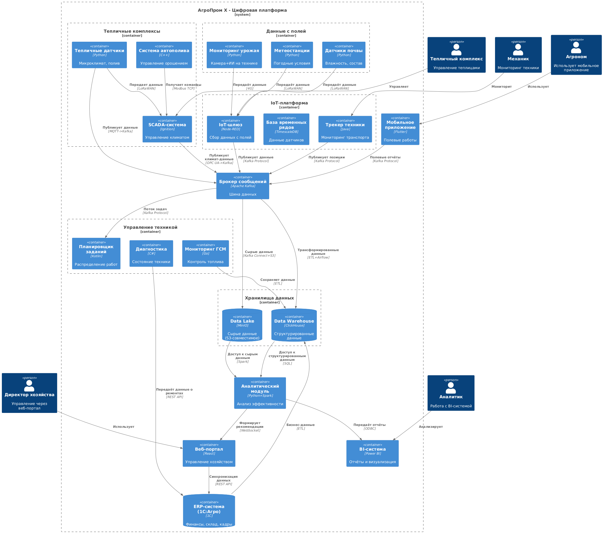

# MSA-AgroTech
Сдача проектной работы 1 спринта

# Примечания от меня (студента):

## Задание 1
- Сделал 2 диаграммы C1 основное и альтернативное решение.
- В ADR подсветил нюансы по каждому

## Задание 2
- Сделал C2 диаграммы для обоих решений + ADR

## Задание 3
С куратором было обговорено что делать C3-C4 для всего сервиса плюс в двух вариантах решения это too much.
[Тред в пачке](https://app.pachca.com/chats/33211951?thread_message_id=760494777&message=760494777)
- Выбрал пару по 1-2 сервиса из каждого решения, сделал для них C3
- Из сделанных C3 выбрал еще по одному компоненту и сделал для них C4

## Задание 4
Тут, по скольку в задании идет речь для MVP, решил выбрать вариант с "тонким" агентом на ферме чтобы не содержать 
дорогую ML инфру на каждой ферме особенно в рамках MVP.
- Сделал ADR

# Сдача проектной работы 1 спринта

В этом уроке вам предстоит сдать проектную работу первого спринта. Здесь вы найдёте описание заданий и форму, в которую нужно отправить ответ. Она появится после нажатия на кнопку «Сдать работу» в конце страницы.

---

## О компании

Микросервисная архитектура способна решать специфические задачи и в аграрной сфере (AgTech): от точного земледелия и управления техникой до отслеживания цепочек поставок и анализа данных.

Компания «АгроТех Х» давно работает на рынке, занимается выращиванием различных культур, имеет 150 тепличных комплексов по всей стране и занимается свиноводством. У компании есть свой собственный парк техники.

IT-ландшафт компании формировался постепенно, и там можно встретить как достаточно современные, так и совсем устаревшие технологии, от которых постепенно отказываются.

По мере развития IoT компания пробует различные датчики и системы в своей работе. Например, для парка техники внедрён мониторинг местоположения, состояния, расхода топлива, выполнения работ множества единиц техники (тракторы, комбайны, опрыскиватели) разных производителей для планирования заданий, сокращения издержек и повышения производительности.

Сейчас перед компанией стоит задача — повысить эффективность в сфере животноводства и по максимуму автоматизировать процессы, связанные с кормлением, безопасностью и мониторингом поголовья скота.

На рынке уже представлены продукты из этой сферы: это PigVision, ALUS или PigTales, есть различные исследования и проекты:  
https://blog.iotcloudplatform.com/how-to-design-an-iot-smart-pig-farming-system/

Но купить и адаптировать их в настоящих реалиях не получится либо из-за ограничений в законодательстве, либо из-за дороговизны реализации. Например, использование дронов для мониторинга скота.

Поэтому решено сделать MVP архитектуры c нуля и запустить как отдельную платформу для мониторинга скота. Сначала планируется реализовать это на ограниченном количестве ферм, а затем потенциально предлагать как SaaS-решение для других компаний — это уже выходит за рамки проектной работы.

---

## Функциональные требования к системе

Система должна:

- фиксировать признаки беспокойного поведения или драк среди животных и оповещать оператора;
- фиксировать признаки задавливания поросят;
- управлять кормушками и поилками разных производителей;
- оценивать состояние животных по внешнему виду и поведению: болезнь, гибель, беспокойство и так далее;
- следить за состоянием систем фильтрации воды;
- пересчитывать поголовье;
- следить за запасами еды и прогнозировать расход;
- делать пересчёт животных;
- поддерживать необходимое количество видеокамер для аналитики в реальном времени от разных производителей;
- быть построена по принципу «центральный сервер — агенты» на конкретных фермах без ограничения количества таких агентов (в синхронизации между агентами и центральным сервером допускается задержка до 10 минут без учёта проблем со связью);
- предоставлять базовые метрики для передачи в другие системы;
- поддерживать возможность добавления собственных метрик;
- работать даже в случае отсутствия интернета и при необходимости отправлять уведомления дежурному сотруднику на местах мониторинга, а после восстановления связи синхронизироваться с центральной системой;
- иметь разделение ролей и поддерживать современные способы аутентификации и авторизации;
- иметь API для создания мобильного приложения или веб-приложения.

---

## Нефункциональные требования

Система должна:

- обеспечивать достаточно высокую отказоустойчивость 99,95%;
- быть расширяемой, то есть иметь возможность разработать новый функционал без изменений существующего;
- иметь высокую производительность — от момента возникновения нештатной ситуации, зафиксированной с помощью видеоаналитики, должно проходить не более 5 секунд до момента оповещения;
- позволять системе видеоаналитики реагировать в реальном времени (миллисекунды).

---

## Что нужно учесть

### Нейронные сети

Часто нейронные сети путают тень животного с самим животным — для MVP не критично.

Проблемы с освещением — камеры должны уметь снимать и в ночное время суток.

Трекинг животных достаточно сложен, так как особи очень похожи.

Готовую нейросетевую модель предоставят партнёры.

### Инфраструктура

На ферме нестабильный WiFi, поэтому нужно продумать альтернативные каналы связи.

Покрытие камерами всей площади — нужно по максимуму убрать слепые зоны либо воспользоваться камерами типа «рыбий глаз», но это снизит качество в силу выпуклости линзы.

На каждой ферме допустимо использовать один центральный сервер и необходимый набор edge-устройств.

---

## Архитектура компании «АгроТех Х»

---

## Цели бизнеса

Собрать MVP для мониторинга свиноводческих ферм, который работает в соответствии с указанными требованиями на нескольких фермах.

---

## Что нужно сделать

Проект этого спринта вы будете сдавать в Git-репозитории. Создайте публичный репозиторий в GitHub или GitLab. Назовите его «MSA-AgroTech».

Проект состоит из четырёх заданий. Решение каждого задания нужно будет залить в отдельную директорию. Создайте в репозитории четыре директории и назовите их «Task1», «Task2», «Task3» и «Task4».

Чтобы ревьюеру было проще проверять вашу работу, а вам отслеживать изменения на разных итерациях, загрузите файлы в свой репозиторий и сделайте пул-реквест. На ревью нужно отправить ссылку на пул-реквест.

---

## Задание 1. Разработка вариантов решений

Для утверждения сроков и стоимости MVP бизнес хочет увидеть проект решения задачи. Так будет понимание, что нужно доработать или разработать в головном офисе, а что — в сервисах-агентах на местах.

Обычно готовится не один вариант решения, а несколько, чтобы можно было найти компромисс по стоимости, времени и ресурсам на разработку.

### Что нужно сделать

Составьте контекстную (С1) диаграмму в нотации С4 для понимания, какие текущие сервисы могут быть полезны, а какие необходимо будет добавить. Подготовьте два решения: основное и альтернативное.

Составьте ADR. Добавьте в ADR проблему, детали и контекстную диаграмму основного решения и альтернативного.

Решений по организации команд и стекам делать не нужно. Если на данном этапе уже есть компромиссы, добавьте их в соответствующий блок ADR.

Чтобы сдать решение в формате ADR, используйте [шаблон](tasks_description_src/md/adr_template_1.md).

Выполнить задания вы можете с помощью PlantUML или Mermaid.

В результате у вас должно получиться два варианта контекстных диаграмм (C1), а также ADR. Загрузите их в директорию Task1 вашего репозитория.

---

## Задание 2. Проработка высокоуровневого видения решений

Пора погружаться глубже и сформировать высокоуровневое видение на уровне контейнерной диаграммы (С2).

### Что нужно сделать

Сформируйте ограниченные контексты, которые позволят спроектировать конкретные микросервисы, и опишите их в ADR. Добавьте компромиссы и риски каждого решения.

Составьте несколько вариантов диаграмм контейнеров.

Проработайте интеграции между сервисами и сделайте обоснование выбора того или иного подхода и технологии. Зафиксируйте возникшие компромиссы.

Например, для очереди мы выбрали RabbitMQ.

**Преимущества:**
- возможность использовать MQTT для взаимодействия с устройствами;
- распространённая технология;
- не требовательна к ресурсам;
- поддаётся кластеризации.

**Ограничение:**  
при определённом пороге нагрузки лучше использовать другую технологию, например Kafka.

В результате у вас должно получиться две диаграммы C2 — по одной для каждого возможного решения и ADR. Загрузите их в директорию Task2 вашего репозитория.

---

## Задание 3. Детализация решений

Для детализации решения и передачи его в разработку необходимо рассказать команде, из каких конкретных сервисов будет состоять сервис.

### Что нужно сделать

Составьте в нотации C4 диаграммы:
- на уровне C3 — компонентная диаграмма;
- на уровне C4 — диаграмма кода.

В результате у вас должны быть сформированы диаграммы на уровнях С3 и С4 для двух вариантов решений. Загрузите их в директорию Task3 вашего репозитория.

---

## Задание 4. Проработка критериев выбора решения

Бизнесу важно выбрать конкретное решение.

### Что нужно сделать

Сформируйте критерии для сравнения двух решений.

Проанализируйте каждый вариант по выделенным критериям.

Резюмируйте, какое решение вы рекомендуете.

Добавьте это в ADR.

В результате у вас должны быть ADR с критериями для сравнения каждого решения, анализом ваших вариантов системы по ним и личным резюме. Загрузите их в директорию Task4.

---

## Как сдать работу

В директории Task1 должны лежать два варианта контекстных диаграмм, а также ADR.

В директорию Task2 нужно загрузить две диаграммы C2 и ADR для предложенных решений.

В директории Task3 должны быть диаграммы C3 и C4 для каждого из двух вариантов архитектур.

В Task4 — ADR с анализом каждого решения.

Перед отправкой решения проверьте, что вы включили в пул-реквест все нужные файлы. Если всё готово, отправьте ссылку на пул-реквест во вкладке «Ревью».

Не забудьте проверить, что репозиторий публичный. Если создадите приватный репозиторий, ревьюер не сможет прокомментировать ваше решение и вернёт его на доработку.

После того как отправите ссылку, не вносите изменения в проект. Дождитесь комментариев ревьюера.