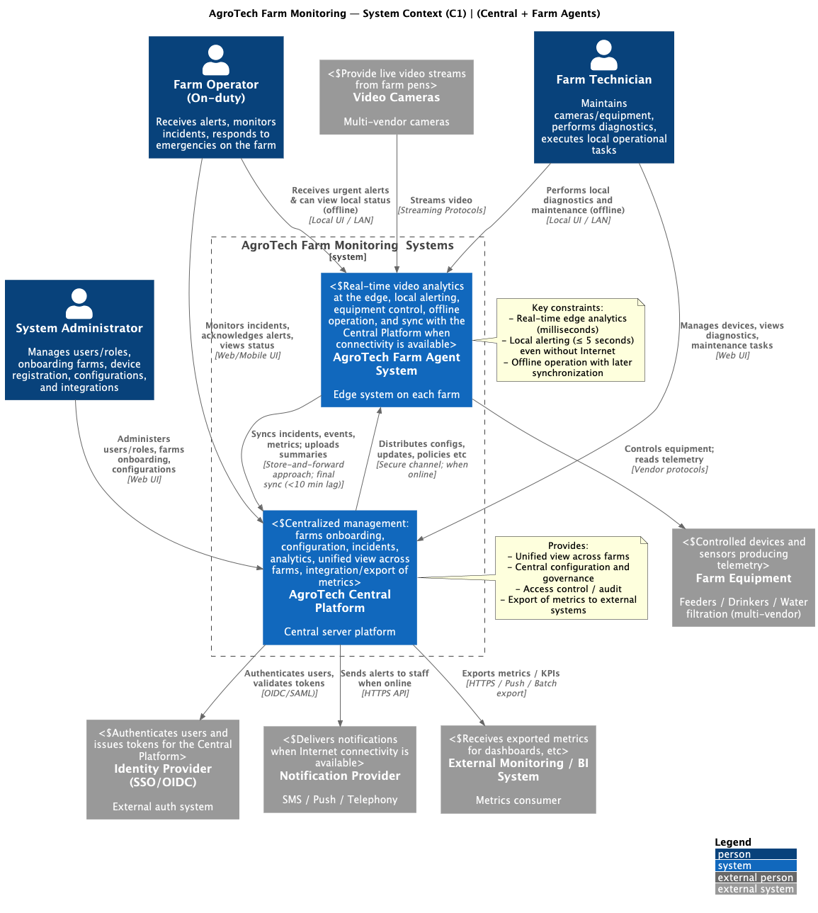
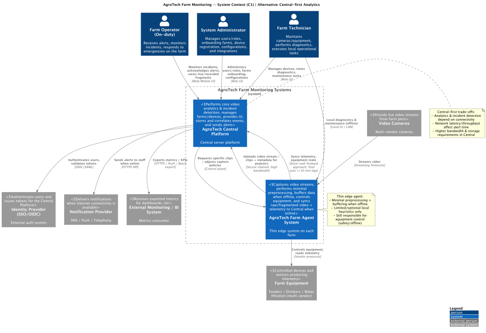

### **Название задачи:** Архитектурное решение для системы мониторинга и видеоаналитики на фермах (Central Platform + Farm Agent)

### **Автор:** Iaroslav L

### **Дата:** 2026-01-31

---

### **Функциональные требования**

|**№**|**Действующие лица или системы**|**Use Case**|**Описание**|
| :-: | :- | :- | :- |
| 1 | Оператор фермы | Получение оповещений об инцидентах | Оператор получает уведомление о драках, задавливании или гибели животных с задержкой не более 5 секунд |
| 2 | Farm Agent | Детекция инцидентов | Farm Agent анализирует видеопотоки с камер и выявляет нештатные ситуации в реальном времени |
| 3 | Farm Agent | Управление оборудованием | Farm Agent управляет кормушками, поилками и системами фильтрации воды |
| 4 | Farm Agent | Автономная работа | Farm Agent продолжает работу при отсутствии интернет-соединения |
| 5 | Central Platform | Централизованное управление | Центральная система управляет фермами, устройствами, пользователями и конфигурациями |
| 6 | Central Platform | Синхронизация данных | Central Platform принимает события и метрики от Farm Agent после восстановления связи |
| 7 | Администратор системы | Управление пользователями | Администратор управляет ролями, доступами и настройками системы |

---

### **Нефункциональные требования**

|**№**|**Требование**|
| :-: | :- |
| 1 | Задержка обнаружения инцидента — миллисекунды |
| 2 | Доставка оповещений оператору — не более 5 секунд |
| 3 | Поддержка автономной работы фермы без интернета |
| 4 | Допустимая задержка синхронизации между агентом и центром — до 10 минут |
| 5 | Масштабируемость на множество ферм |
| 6 | Поддержка оборудования разных производителей |
| 7 | Отказоустойчивость и локальная обработка критических сценариев |
| 8 | Минимизация сетевого трафика между фермой и центральной системой |

---

### **Решение**

Выбрана архитектура с явным разделением системы на два программных компонента:

- **AgroTech Central Platform**  
  Центральная система, отвечающая за:
  - управление фермами и устройствами;
  - конфигурацию и администрирование;
  - пользовательские интерфейсы;
  - агрегацию событий и метрик;
  - интеграцию с внешними системами.

- **AgroTech Farm Agent System**  
  Edge-система, развернутая на каждой ферме, отвечающая за:
  - видеоаналитику и детекцию инцидентов в реальном времени;
  - локальное оповещение персонала;
  - управление оборудованием;
  - автономную работу без интернет-соединения;
  - последующую синхронизацию данных с центральной платформой.

Видеоаналитика и принятие решений по инцидентам выполняются на стороне Farm Agent (edge-first подход)

Контекстная диаграмма (C1) отражает взаимодействие Central Platform, Farm Agent, операторов фермы, оборудования, видеокамер и внешних систем аутентификации и уведомлений

Схема C1 основного решения

Данный подход выбран для выполнения требований по низкой задержке, автономной работе и отказоустойчивости

---

### **Альтернативы**

**Central-first analytics (тонкий агент)**  
Видеоаналитика и детекция инцидентов выполняются в Central Platform, Farm Agent отвечает только за захват и передачу видеоданных

Схема C1 альтернативного решения

**Преимущества:**
- Единая точка обновления и управления ML-моделями
- Более простая архитектура edge-устройств

**Недостатки:**
- Зависимость от интернет-соединения
- Риск превышения допустимых задержек оповещений
- Высокие требования к сетевой пропускной способности
- Невозможность полноценной автономной работы

Альтернатива отклонена, так как не удовлетворяет ключевым нефункциональным требованиям

---

**Недостатки, ограничения, риски**

- Повышенные требования к вычислительным ресурсам Farm Agent
- Сложность обновления и контроля версий ML-моделей на множестве edge-устройств
- Необходимость мониторинга состояния агентов и механизмов восстановления
- Риск рассинхронизации данных при длительном отсутствии связи