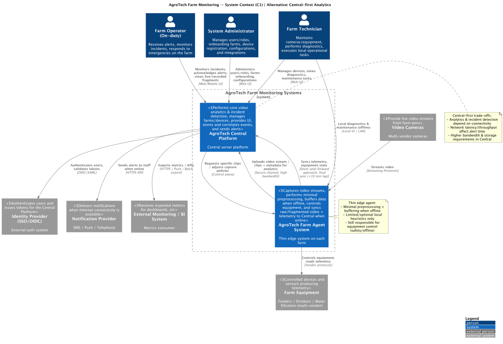
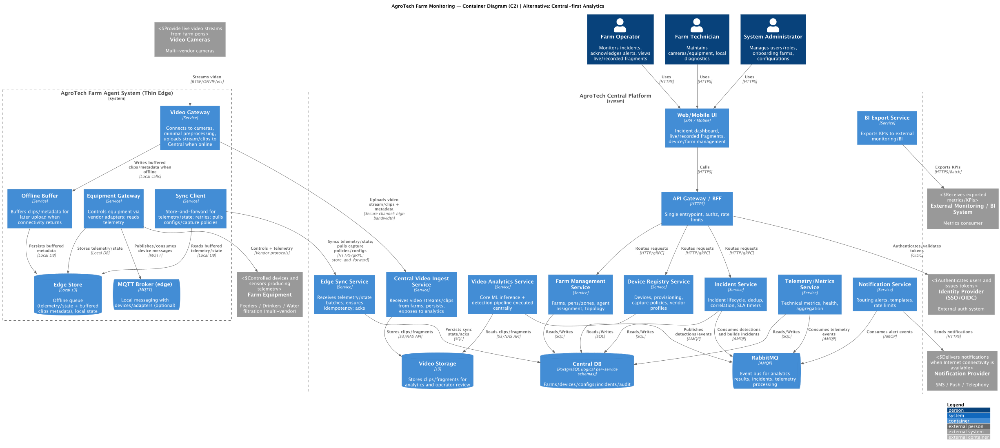
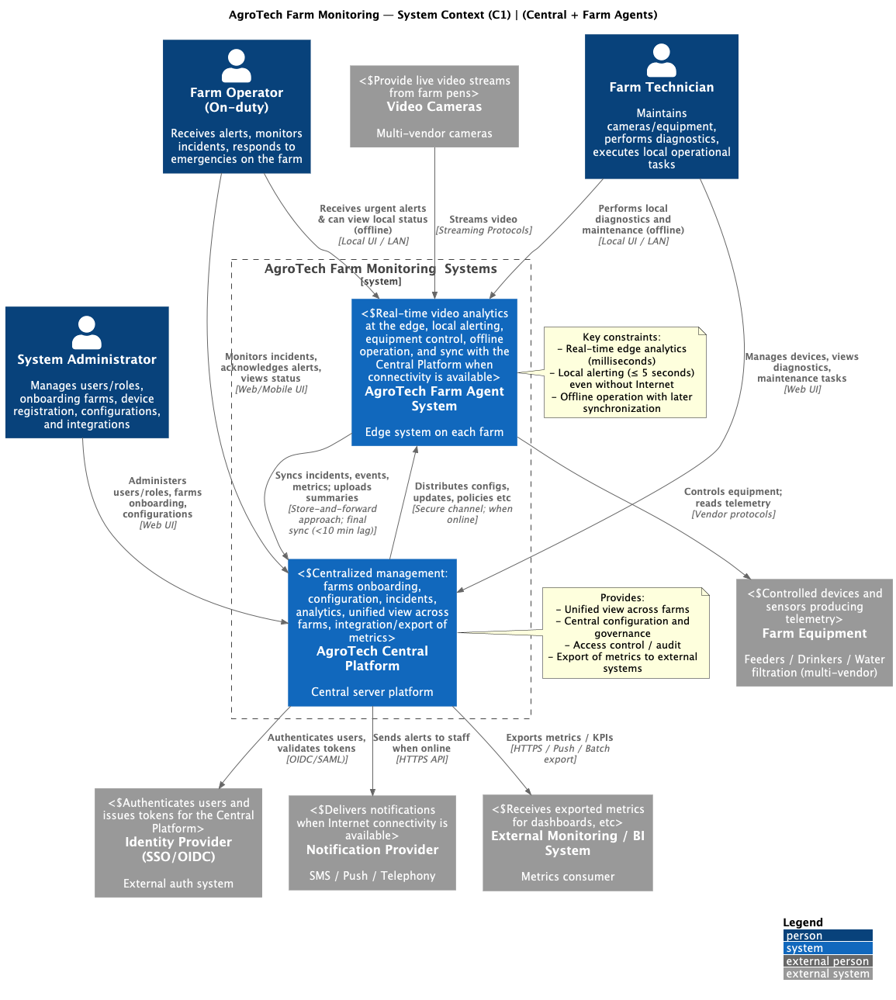

### **Название задачи:** Архитектурное решение для системы мониторинга и видеоаналитики на фермах (Central-first analytics + Thin Farm Agent)

### **Автор:** Iaroslav L

### **Дата:** 2026-02-03

---

### **Функциональные требования**

|**№**|**Действующие лица или системы**|**Use Case**|**Описание**|
| :-: | :- | :- | :- |
| 1 | Оператор фермы | Получение оповещений об инцидентах | Оператор получает уведомление о драках, задавливании или гибели животных (при наличии интернет-соединения и доступности центральной платформы) |
| 2 | Central Platform | Детекция инцидентов | Central Platform анализирует видеопотоки/клипы и выявляет нештатные ситуации |
| 3 | Farm Agent | Захват и доставка видеоданных | Farm Agent подключается к камерам и передает потоки/клипы в центральную систему (или буферизует при потере связи) |
| 4 | Farm Agent | Управление оборудованием | Farm Agent управляет кормушками, поилками и системами фильтрации воды (включая оффлайн-режим) |
| 5 | Farm Agent | Буферизация данных при оффлайне | Farm Agent буферизует клипы/метаданные и телеметрию при отсутствии интернета для последующей отправки |
| 6 | Central Platform | Централизованное управление | Центральная система управляет фермами, устройствами, пользователями, конфигурациями и политиками захвата видео |
| 7 | Central Platform | Синхронизация данных | Central Platform принимает телеметрию/состояние и подтверждения от Farm Agent после восстановления связи |
| 8 | Администратор системы | Управление пользователями | Администратор управляет ролями, доступами и настройками системы |

---

### **Нефункциональные требования**

|**№**|**Требование**|
| :-: | :- |
| 1 | Минимизация стоимости инфраструктуры на стадии MVP (CAPEX/OPEX) |
| 2 | Упрощение эксплуатации и обновлений ML-моделей (единая точка деплоя) |
| 3 | Масштабируемость на множество ферм |
| 4 | Поддержка оборудования разных производителей |
| 5 | Буферизация данных на ферме при отсутствии интернета (store-and-forward) |
| 6 | Допустимая задержка синхронизации телеметрии/состояния между агентом и центром — до 10 минут |
| 7 | Наблюдаемость и контролируемая деградация качества сервиса при проблемах связи |
| 8 | Допустимость риска пропуска real-time алертов при недоступности центральной платформы (для MVP) |

> Примечание: строгие требования “детекция в миллисекундах” и “оповещение ≤ 5 секунд в любых условиях” осознанно **не гарантируются** в оффлайн-сценариях для MVP, так как аналитика выполняется в центральной платформе и зависит от канала связи.

---

### **Решение**

Выбрана архитектура с явным разделением системы на два программных компонента, при этом видеоаналитика централизована:

- **AgroTech Central Platform**  
  Центральная система, отвечающая за:
  - прием видеопотоков/клипов (Central Video Ingest Service) и хранение фрагментов;
  - выполнение ML-видеоаналитики и детекции инцидентов (Video Analytics Service);
  - управление инцидентами и оповещениями;
  - управление фермами/устройствами, конфигурациями и политиками захвата видео;
  - интеграции с внешними системами.

- **AgroTech Farm Agent System (Thin Agent)**  
  Edge-система на каждой ферме, отвечающая за:
  - подключение к камерам и минимальную предобработку (Video Gateway);
  - передачу потоков/клипов в центр при наличии связи;
  - буферизацию клипов/метаданных и телеметрии при отсутствии интернета (Offline Buffer + Edge Store);
  - управление оборудованием разных производителей;
  - синхронизацию состояния/телеметрии и получение политик захвата видео из центра.

Видеоаналитика и детекция инцидентов выполняются **в Central Platform** (central-first подход).

Контекстная диаграмма (C1) отражает взаимодействие Central Platform, Thin Farm Agent, операторов фермы, оборудования, видеокамер и внешних систем аутентификации и уведомлений.

Схема C1 альтернативного решения

Контейнерная диаграмма (C2) отражает перенос ML-инференса в центр: наличие Central Video Ingest Service, Video Analytics Service и Video Storage; на ферме — Video Gateway и Offline Buffer.

Схема C2 альтернативного решения  

#### Обоснование выбора для MVP
Данный вариант выбран как **дешевле и проще для MVP** по сравнению с edge-first решением:

- ML-инфраструктура на каждой ферме (GPU/ускорители, обслуживание, мониторинг, обновления) значительно увеличивает CAPEX/OPEX и усложняет поддержку.
- Централизованная аналитика дает:
  - единую точку обновления моделей;
  - быстрый цикл улучшений (time-to-market);
  - меньшие требования к edge-оборудованию (тонкий агент).
- Риск временной недоступности Central Platform для MVP считается **приемлемым**:
  - отказы/недоступность центральной системы рассматриваются как редкие события;
  - бизнесу на старте может быть выгоднее принять риск пропуска части алертов, чем инвестировать в дорогую ML-инфраструктуру на каждой ферме.

**Недостатки, ограничения, риски**
- Зависимость детекции инцидентов от интернет-соединения и доступности центральной платформы.
- Риск превышения целевых задержек оповещений из-за качества канала (latency/throughput/jitter).
- Высокие требования к пропускной способности сети при передаче потоков/клипов.
- Рост затрат на центральную инфраструктуру (storage для видео, CPU/GPU для аналитики).
- Необходимость стратегии деградации: снижение FPS/разрешения, отправка только клипов/фрагментов, ограничение uplink.
- При длительном оффлайне на ферме возможен рост буфера (нужны лимиты хранения и политика очистки).

---

### **Альтернативы**

**Edge-first analytics (толстый агент)**  
Видеоаналитика и детекция инцидентов выполняются на Farm Agent (edge), что обеспечивает автономность и минимальную задержку.

Схема C1 основного решения  

**Преимущества:**
- Минимальная задержка и независимость от интернета.
- Локальная обработка критических сценариев и автономное оповещение.
- Низкие требования к каналу связи и трафику.

**Недостатки:**
- Высокие затраты на вычислительные ресурсы на каждой ферме (ML-инференс).
- Сложность эксплуатации: обновления моделей, мониторинг и обслуживание множества edge-узлов.
- Более высокая стоимость владения (OPEX) при росте числа ферм.

Данная альтернатива рассматривается как целевая эволюция после MVP, если бизнес подтвердит необходимость строгого выполнения real-time и offline требований.